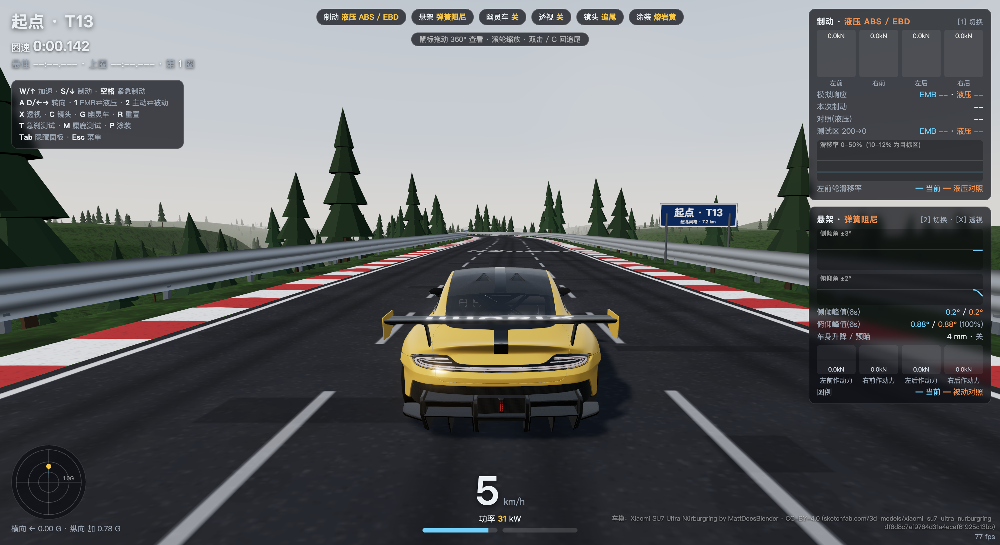
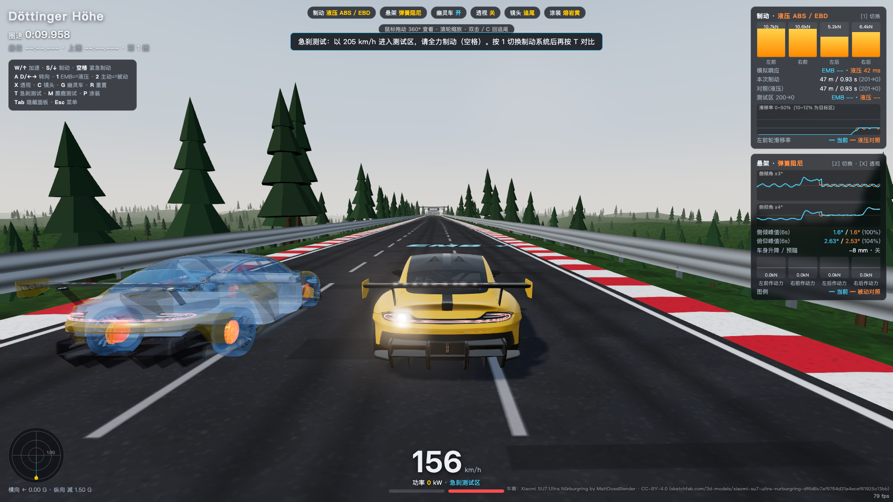

# SU7 Ultra Sim

A Xiaomi SU7 Ultra driving simulator that runs in the browser and as a desktop app for macOS and Windows.
It has no game engine: rendering uses **three.js**, and the vehicle physics model is written from scratch. The model covers tyre grip, hydraulic ABS / EBD and spring-damper suspension, and the car drives on a Nürburgring-style track.

小米 SU7 Ultra 物理驾驶演示。three.js 渲染，车辆物理是自己写的（轮胎抓地、液压 ABS / EBD、弹簧阻尼悬架），在仿纽北赛道上开。




> Physics demo with approximate parameters. Not official Xiaomi data or calibration.
> 物理驾驶演示 · 参数近似，非官方标定。

## Download / 下载

Get the latest build from [Releases](../../releases):

| Platform | File |
| --- | --- |
| macOS (Apple Silicon) | `SU7 Ultra Sim-x.y.z-mac-arm64.dmg` |
| macOS (Intel) | `SU7 Ultra Sim-x.y.z-mac-x64.dmg` |
| Windows 10/11 (x64) | `SU7 Ultra Sim-x.y.z-win-x64.exe` (installer) or `-win-x64.zip` (portable) |

The builds are **not code-signed**, so each OS asks for one extra step the first time you open the app:

- **macOS**: drag the app to Applications, then right-click it → **Open** → **Open**.
  If macOS says the app is "damaged", run `xattr -cr "/Applications/SU7 Ultra Sim.app"` and then open it again.
- **Windows**: if SmartScreen shows "Windows protected your PC", click **More info** → **Run anyway**.

## Controls / 操作

| Key | Action |
| --- | --- |
| `W` / `↑` | Throttle |
| `S` / `↓` | Progressive brake |
| `Space` | Emergency brake (triggers ABS) |
| `A` `D` / `←` `→` | Steer (continuous; returns to centre on release) |
| `1` | Brake system: hydraulic ABS ⇄ EMB concept |
| `2` | Suspension: spring-damper ⇄ fully active concept |
| `X` | X-ray view (suspension) |
| `C` | Camera |
| `G` | Ghost car (passive suspension + hydraulic brakes, same inputs) |
| `T` | 200 → 0 brake test |
| `M` | Moose test |
| `R` | Reset to checkpoint |
| `P` | Paint |
| `F11` | Fullscreen (desktop app) |

## Develop / 开发

Requires Node.js 20+.

```bash
npm install
npm run dev          # web version at http://127.0.0.1:5173
npm run app          # build and run the desktop app locally
npm run dist:mac     # build macOS .dmg/.zip (arm64 + x64) into release/
npm run dist:win     # build Windows installer + zip (x64) into release/
npm run test:sim     # physics self-tests
npm run test:driving # driving regression
```

Project layout:

- `src/`: game source (car model, physics, track, camera, UI)
- `electron/`: desktop shell. The `app://` scheme serves `dist/`; the folder also holds the macOS ad-hoc signing hook.
- `public/`: runtime assets (compressed GLB car model, Draco decoder)
- `docs/`: physics notes and reference screenshots

## Credits & license

- Code: MIT, see [LICENSE](LICENSE).
- Car model: This work is based on ["Xiaomi Su7 Ultra Nurburgring"](https://sketchfab.com/3d-models/xiaomi-su7-ultra-nurburgring-df6d8c7af9764d31a4ecef61925c13bb) by [MattDoesBlender](https://sketchfab.com/MattDoesBlender), licensed under [CC-BY-4.0](http://creativecommons.org/licenses/by/4.0/). The model was compressed and its nodes rearranged for the web. See `public/models/su7ultra.LICENSE.txt`.
- This is an unofficial fan project. It is not affiliated with or endorsed by Xiaomi.
